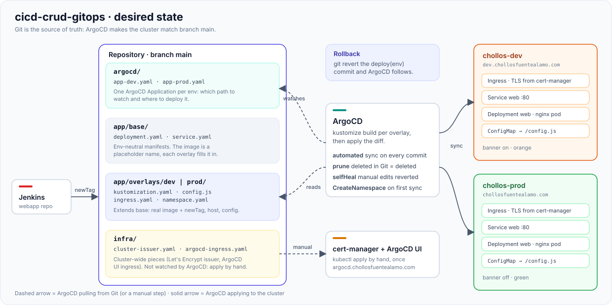

# cicd-crud-gitops

Desired state of the cluster. Nothing is applied by hand from here except `infra/`: ArgoCD watches `main` and makes the cluster match it.

## Layout

| Path | What it does |
|---|---|
| `app/base/` | Env-neutral `Deployment` + `Service`. Image is a placeholder name (`chollos-web`). |
| `app/overlays/dev/`, `prod/` | Per-env namespace, host/Ingress, `config.js` (banner, colors, email) and the real image + `newTag`. |
| `argocd/` | Two ArgoCD `Application`s, one per overlay, both auto-sync with prune and self-heal. |
| `infra/` | Cluster-wide pieces: Let's Encrypt `ClusterIssuer` and the Ingress for the ArgoCD UI. |

## How a deploy happens

- **Image bump:** Jenkins rewrites `newTag:` in the overlay's `kustomization.yaml`. That commit *is* the deploy.
- **Config change:** edit the overlay's `config.js`. Kustomize hashes the ConfigMap name, so pods restart by themselves.
- **Drift:** manual `kubectl` edits get reverted (`selfHeal`); files deleted from Git get deleted from the cluster (`prune`).
- **Rollback:** `git revert` the `deploy(...)` commit.
